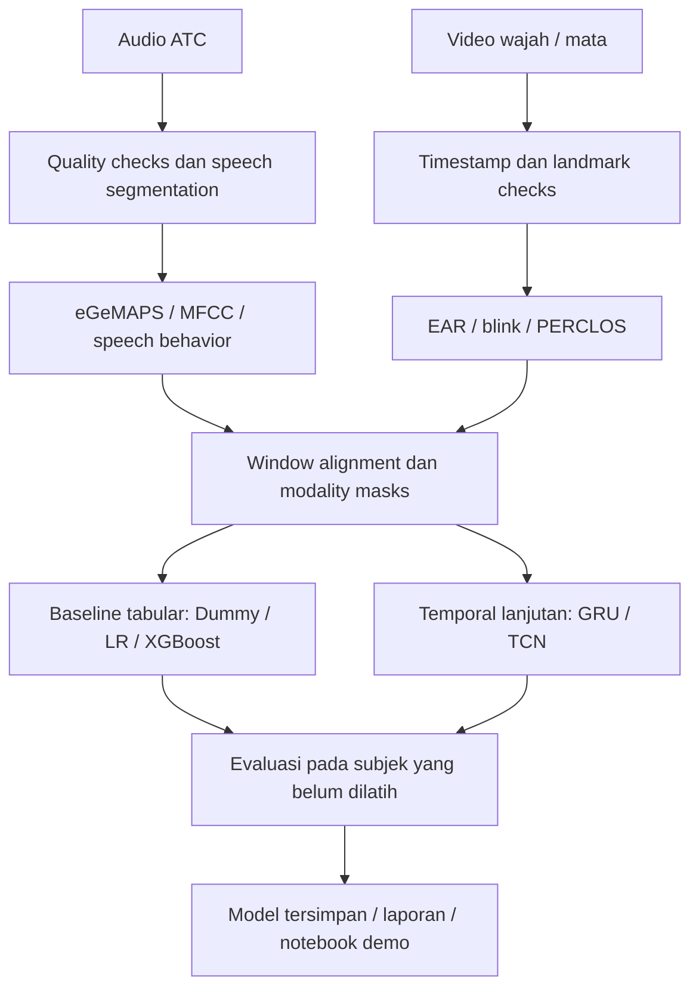

<div align="center">

# ATC Fatigue Research

### Memahami kelelahan operator melalui suara dan perilaku visual.

Fondasi riset **temporal multimodal fatigue detection** untuk Air Traffic Controller.


[Visi](#visi-riset) · [Pipeline](#pipeline-yang-direncanakan) · [Dataset](#dataset-dan-batas-klaim) · [Mulai](#mulai-di-sini) · [Rencana eksekusi](docs/execution-plan.md) · [Roadmap](docs/roadmap.md)

</div>

---

> **Status saat ini — fondasi repositori.** Dokumentasi, struktur kerja, dan kerangka package sudah tersedia. Ekstraksi fitur, training, evaluasi, dan notebook demo belum diimplementasikan. Belum ada skor model atau benchmark yang dihasilkan proyek ini.

## Visi riset

Membangun pipeline yang mempelajari indikasi **fatigue operator ATC** dari dua modalitas yang direkam secara sinkron:

| Audio operator | Video wajah dan mata |
| :--- | :--- |
| Fitur akustik eGeMAPS/MFCC, prosodi, dan pola bicara yang dapat diverifikasi | Eye Aspect Ratio (EAR), kedipan, durasi penutupan mata, dan PERCLOS |
| Mulai dari suara ATC saja; fitur CLC opsional jika komunikasi dua arah tersedia | Gunakan video atau landmark dengan timestamp dan resolusi temporal memadai |

Baseline dimulai dari fitur tabular dan model sederhana. Pemodelan temporal menjadi tahap lanjutan setelah data dan ground truth mendukung. Sistem yang dituju adalah **decision support** yang memerlukan validasi.

**Fatigue, sleepiness, workload, stress, emotion, dan eye state merupakan target berbeda.** Label dan laporan eksperimen harus selalu menyebut target yang benar.

## Pipeline yang direncanakan



Window harus berasal dari **subjek, sesi, dan timeline yang sama**. Modalitas yang hilang ditandai dengan quality/availability masks; fitur yang tidak tersedia tidak boleh diisi seolah merupakan pengukuran valid.

## Dua tujuan fase awal

| Functional smoke test | Scientific benchmark |
| :--- | :--- |
| Membuktikan raw input → fitur → model → reload → inference berjalan | Mengukur performa pada label asli, data sah, dan split yang tepat |
| Fixture sintetis boleh dipakai untuk pengujian teknis dengan flag eksplisit | Fixture sintetis dan pasangan lintas dataset tidak menjadi bukti performa fatigue |
| Output: pipeline modular, cache fitur, notebook, dan run logs | Output: metrik nyata, provenance, split manifest, serta batasan |

## Dataset dan batas klaim

Daftar ini mengikuti [master handoff](ATC_Fatigue_Research_and_Smoke_Test_Master_Handoff.md). **Akses, lisensi, ukuran, dan metadata belum diaudit ulang dalam repo ini.**

| Dataset | Peran yang direncanakan | Target yang boleh dilaporkan |
| :--- | :--- | :--- |
| **ATCOSIM** | Smoke test fitur audio domain ATC | Ekstraksi fitur; tidak memiliki label fatigue |
| **MRL Eye** | Baseline classifier gambar mata | Eye state: open / closed |
| **DROZY** | Landmark temporal, EAR, blink, PERCLOS | Sleepiness berbasis KSS dengan batasan label per test |
| **RAVDESS AV** | Demo fusion audio-video yang benar-benar berpasangan | Emotion classification |
| **IEEE ATC Fatigue Corpus** | Kandidat benchmark audio paling dekat dengan target | Fatigue / non-fatigue, jika akses dan label terverifikasi |

**Tidak ada klaim “multimodal ATC fatigue accuracy” sampai tersedia pasangan audio-video ATC dengan ground truth fatigue yang valid.** Menggabungkan ATCOSIM dan DROZY secara acak tidak menghasilkan benchmark tersebut.

Detail sumber dan pemeriksaan yang diperlukan: [panduan dataset](docs/datasets.md).

## Mulai di sini

1. Baca [master handoff](ATC_Fatigue_Research_and_Smoke_Test_Master_Handoff.md) dan [aturan agent](AGENTS.md).
2. Ikuti [panduan setup](docs/getting-started.md) untuk audit environment dan workspace.
3. Kerjakan milestone awal pada [roadmap](docs/roadmap.md).
4. Catat sumber data, konfigurasi, seed, split, dan hasil nyata setiap eksperimen.

Untuk checkout baru:

```bash
gh-orie repo clone maulnite/atc-fatigue-research
cd atc-fatigue-research
```

Folder kerja sesi saat ini sudah menjadi checkout repo ini; tidak perlu clone ulang. Dependensi audio, visual, dan training akan dipilih setelah audit environment. Belum ada perintah training atau demo yang siap dijalankan.

## Peta repositori

```text
.
├── README.md                    # Ikhtisar dan pintu masuk proyek
├── AGENTS.md                    # Aturan kerja agent untuk proyek ini
├── ATC_Fatigue_Research_and_Smoke_Test_Master_Handoff.md
├── pyproject.toml               # Metadata package; dependensi riset belum dipilih
├── docs/                        # Setup, dataset, dan roadmap
├── configs/                     # Konvensi konfigurasi eksperimen
├── src/atc_fatigue/              # Kerangka package Python
├── scripts/                     # Tempat entry point CLI mendatang
├── notebooks/                   # Tempat EDA dan demo yang memanggil modul .py
├── tests/                       # Rencana pengujian metodologis dan teknis
├── data/                        # Raw, manifests, interim, processed; lokal
├── models/                      # Artefak model; lokal
└── reports/                     # Audit, metrics, figures, dan run logs
```

## Standar eksperimen

- **Generalisasi:** pisahkan subjek/aktor antara train dan test jika metadata mendukung; cegah overlap sesi dan duplikasi.
- **Preprocessing:** fit imputer, scaler, dan feature selection hanya pada training fold.
- **Evaluasi:** majority-class baseline, Macro F1, balanced accuracy, confusion matrix, dan per-class recall.
- **Reproduksibilitas:** simpan seed, konfigurasi, versi extractor, split manifest, feature schema, serta prediksi holdout jika diizinkan.
- **Pelaporan:** angka baru ditulis setelah eksekusi; hasil paper dibedakan dari hasil proyek ini.

Kriteria penerimaan lengkap ada dalam [roadmap](docs/roadmap.md) dan master handoff.

## Data, akses, dan lisensi

Data mentah, cache fitur, checkpoints, dan model tidak dimasukkan ke Git. File contoh harus sintetis atau memiliki izin penggunaan yang jelas. Suara dan wajah operator memerlukan pengelolaan akses yang sesuai; dataset tidak otomatis mewarisi ketentuan repositori.

Lisensi kode proyek belum ditentukan. Tidak ada lisensi open-source yang diberikan saat ini. Lisensi dan ketentuan setiap dataset wajib diperiksa sebelum penggunaan atau distribusi.

Untuk kontribusi dan pencatatan eksperimen, lihat [CONTRIBUTING.md](CONTRIBUTING.md).

---

<div align="center">

**Audio + visual · label yang tepat · evaluasi yang dapat diulang**

</div>
