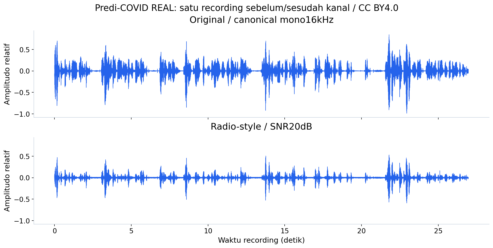
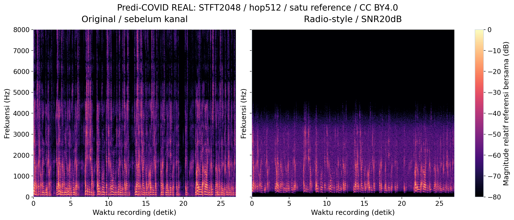
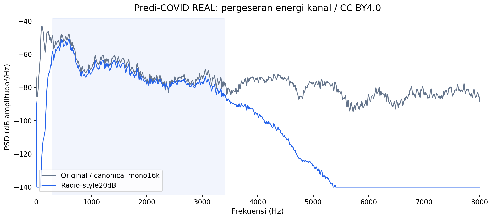
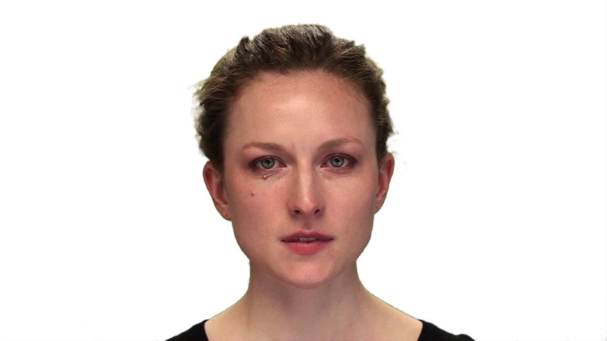

# Contoh media asli untuk smoke test

Contoh berikut benar-benar berasal dari recording test yang dipakai notebook v3. Pemilihan memakai sample ID pertama yang terurut pada test split, bukan berdasarkan prediksi yang paling bagus. Media hanya contoh kecil; dataset lengkap, checkpoint dan feature cache tetap terpisah.

## Dengarkan clean versus radio dari recording yang sama

- [Source WAV asli, tanpa perubahan isi](predi_source.wav)
- [Clean — mono 16 kHz sebelum simulasi kanal](predi_clean.wav)
- [Radio-style — recording yang sama, SNR 20 dB](predi_radio20.wav)

Kedua versi clean/radio juga tertanam sebagai player di [notebook audio](../../notebooks/v3/01_audio_analysis.ipynb). Jika renderer GitHub tidak menampilkan tombol play, gunakan **Download raw file** pada tautan WAV. Aplikasi Jupyter dapat memainkan embedded player.

Clean bukan jaminan bebas noise: istilah ini berarti sebelum simulasi tambahan. Transformasi: Butterworth SOS order 4, 300–3400 Hz, forward-backward offline, gain −3 dB, band-limited Gaussian noise 20 dB dengan seed per recording. Tidak ada codec. Content, label dan orangnya tidak berubah.

**Yang terlihat:** envelope ucapan yang sama tetap dapat dikenali; gain/filter mengubah amplitudo. **Artinya:** transformasi mengubah kanal input, bukan kondisi fatigue. **Perlu diingat:** satu contoh tidak menunjukkan generalisasi model.

**Yang terlihat:** energi di luar voice band ditekan; noise terkontrol mengubah noise floor. **Artinya:** representasi spektral yang diterima extractor berubah. **Perlu diingat:** ini kanal buatan, bukan pengukuran radio ATC nyata.

**Yang terlihat:** kurva PSD memakai recording, satuan dan sumbu yang sama. **Artinya:** filter mengubah distribusi energi frekuensi. **Perlu diingat:** perubahan fitur tidak boleh dibaca sebagai perubahan label klinis.

## Lihat pasangan audio-video asli RAVDESS

[Recording AV yang sama dengan contoh test pertama pada notebook fusion](ravdess_paired_example.mp4). Jika preview video tidak muncul di GitHub, pilih **Download raw file** dan buka dengan video player.

Frame ini memperlihatkan sumber visual aktual. Fitur HOG pada eksperimen adalah appearance features, bukan EAR/PERCLOS; targetnya emotion, bukan fatigue.

## Atribusi dan lisensi per dataset

**Predi-COVID:** Abir Elbéji, Lu Zhang, Eduardo Higa, Aurélie Fischer, Vladimir Despotovic, Petr V. Nazarov, Gloria A. Aguayo, dan Guy Fagherazzi (2022), *Audio recordings of COVID-19 positive individuals from the prospective Predi-COVID cohort study with their fatigue status*. [Sumber/DOI](https://doi.org/10.5281/zenodo.5937844), [CC BY 4.0](https://creativecommons.org/licenses/by/4.0/).
`predi_source.wav` hanya diganti nama file; clean diubah menjadi mono16kHz/PCM16, radio mendapat simulasi kanal, dan tiga PNG adalah visualisasi turunan. Credit dan lisensi tersebut berlaku untuk contoh audio serta adaptasinya; tidak menyatakan dukungan penulis terhadap proyek ini.

**RAVDESS:** Steven R. Livingstone dan Frank A. Russo (2018), *The Ryerson Audio-Visual Database of Emotional Speech and Song (RAVDESS)*. [Sumber/DOI](https://doi.org/10.5281/zenodo.1188976), [CC BY-NC-SA 4.0](https://creativecommons.org/licenses/by-nc-sa/4.0/). MP4 tidak diubah isinya; JPEG diekstrak sekitar500ms dan dikodekan JPEG tanpa cropping. Contoh ini untuk penggunaan nonkomersial; adaptasi frame dibagikan dengan lisensi CC BY-NC-SA 4.0 yang sama. Ini lisensi media terkait, bukan lisensi baru seluruh repository.

Manifest [provenance/checksum](../../reports/notebook_v3_media_publication.json) mencatat sumber, license, hash, parameter transformasi dan run ID. Nama file publik tidak mengandung participant ID atau label klinis.

## Media yang belum dibagikan

ATCOSIM melarang redistribusi kepada pihak ketiga; DROZY mensyaratkan izin tertulis dan membatasi penampilan gambar. Izin redistribusi MRL/CogBeacon belum terverifikasi. Karena itu media sumber dataset tersebut tetap lokal; hasil eksperimen dan ilustrasinya tetap dapat diperiksa pada notebook.
