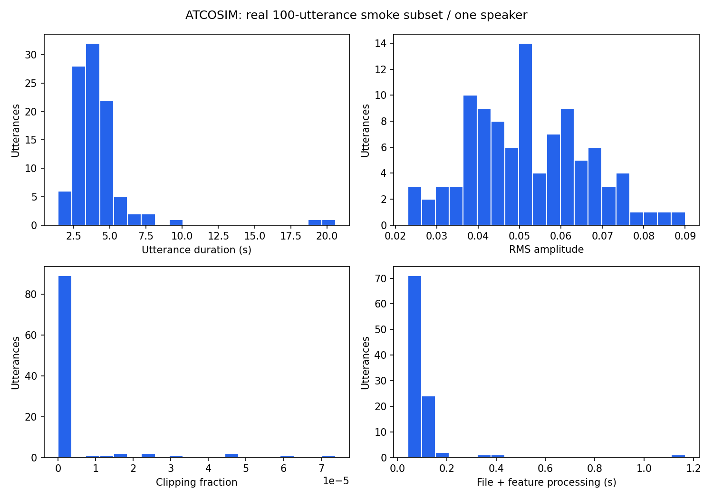

# Pelengkapan teknis smoke test

Snapshot: 2026-10-21T14:31:17.350209+00:00

Profiling pada data lokal, tanpa download, tuning, atau penggantian model/score canonical. Pengukuran satu pass dengan OS cache hangat; bukan studi cold-start, throughput server, atau validasi real-time.

| Tahap | Sampel / unit yang diproses | Durasi (s) | Scope |
| :--- | ---: | ---: | :--- |
| ATCOSIM audio pipeline | 100 | 10.4951 | manifest/checksums/file read/resample/eGeMAPS/MFCC/output write |
| MRL HOG extraction | 5285 | 7.6320 | all selected images; file read/resize/HOG |
| MRL fixed training | 3234 | 2.4474 | unchanged estimator and original training split; no tuning/new score |
| MRL holdout inference | 1159 | 0.0126 | existing saved model; features already in memory |
| DROZY landmark IO | 1 | 0.1741 | one original approximately 10-minute test, not all 36 tests |
| DROZY EAR | 17865 | 0.5462 | 68-point EAR, one test |
| DROZY window aggregation | 17865 | 0.0346 | timestamp-aware windows; one test |
| KSS fixed fold training | 33 | 0.0042 | first LOSO fold only; unchanged alpha; no tuning/new score |
| KSS fold inference | 3 | 0.0012 | original held-out subject; test-level features in memory |
| RAVDESS audio decode | 1 | 0.1224 | one AV clip -> mono 16kHz; ffmpeg process startup included |
| RAVDESS acoustic extraction | 1 | 0.0724 | one decoded clip; warm extractor after ATCOSIM |
| RAVDESS face appearance extraction | 1 | 1.0715 | one AV clip; sampled face HOG; not full-128 extraction or blink measurement |
| RAVDESS audio_only fixed training | 64 | 0.0145 | original actor split; same estimator; no tuning/new score |
| RAVDESS audio_only holdout inference | 32 | 0.0017 | saved model, features in memory |
| RAVDESS visual_only fixed training | 64 | 0.0762 | original actor split; same estimator; no tuning/new score |
| RAVDESS visual_only holdout inference | 32 | 0.0172 | saved model, features in memory |
| RAVDESS audio_visual fixed training | 64 | 0.0933 | original actor split; same estimator; no tuning/new score |
| RAVDESS audio_visual holdout inference | 32 | 0.0205 | saved model, features in memory |

## QC audio

100 utterances dari 1 speaker. Missing cells fitur: 0.0000%. Kolom konstan pada subset: 0; ini bukan alasan otomatis membuang fitur pada dataset lain.

Durasi total 425.61 detik. Clipping fraction mean=0.000004, max=0.000074; RMS median=0.051524. RMS/clipping bukan estimasi SNR atau VAD.

## Pengujian dan waktu label

Tests tambahan memeriksa file video rusak, video sintetis tanpa wajah, sampling rate tidak valid, feature timestamp tidak diketahui, serta label input online yang baru tersedia setelah waktu prediksi atau berasal dari subjek/sesi lain. Video tanpa wajah menghasilkan NaN + availability=false, bukan fitur wajah palsu.

Guard waktu label bersifat kausal untuk label yang dipakai sebagai input online. Ground truth retrospektif untuk training dapat dikumpulkan setelah interval yang dinilai; pemetaan tersebut tetap memerlukan protokol eksplisit dan belum dibangun untuk data ATC nyata.

Benchmark IEEE audio fatigue masih memerlukan akses. VAD pada rekaman kontinu, kalibrasi visual terhadap ground truth, protokol pengumpulan data, dan benchmark temporal multimodal ATC belum selesai. Lihat [checklist handoff](handoff_coverage.md).

## Validasi tahap pelengkapan

Seluruh **39 tests lulus**, tanpa failures/errors. Ruff dan `pip check` lulus. Terdapat deprecation warnings nonfatal pada dependensi plotting. Tidak ada dataset baru yang diunduh atau skor canonical yang ditimpa. Notebook visual yang telah berubah lokal tidak ditimpa maupun diregenerasi; hasil Run All sebelumnya tetap snapshot historis.
