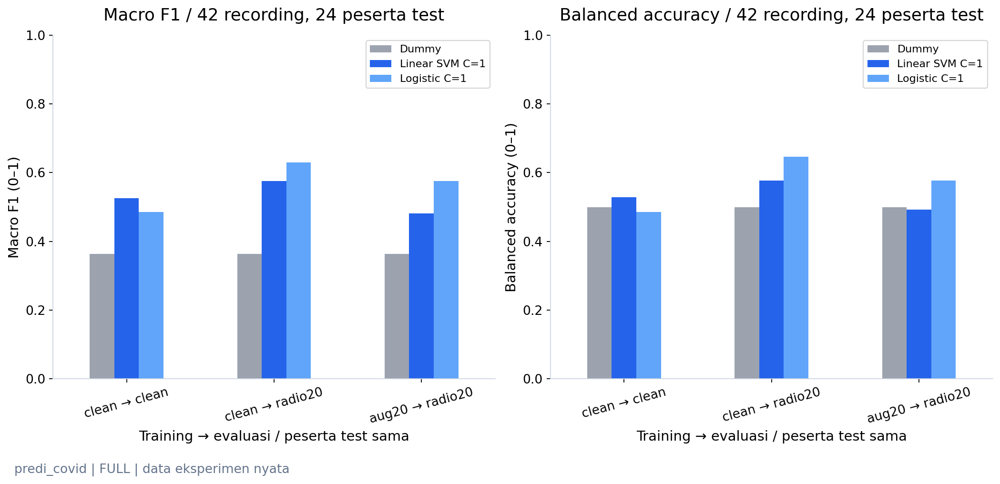
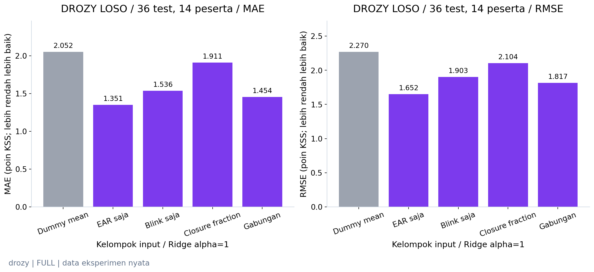
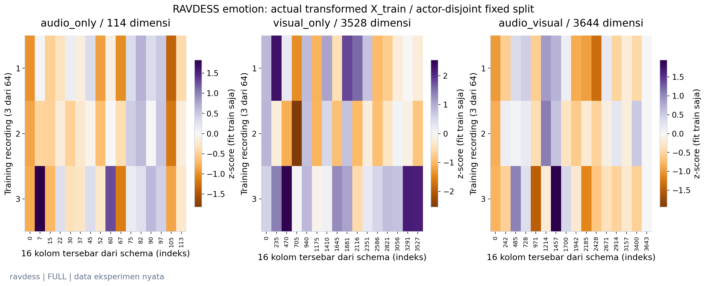
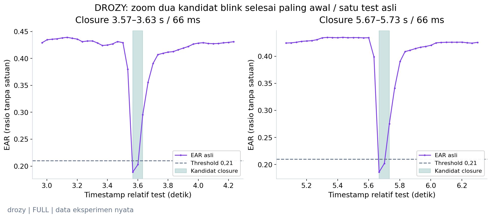
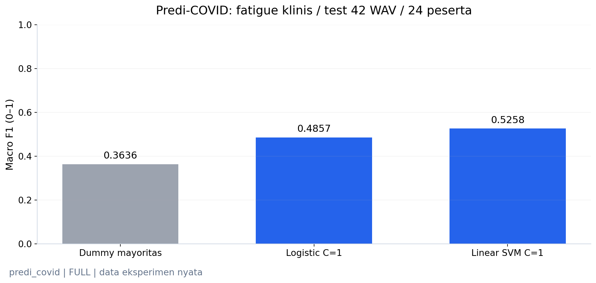
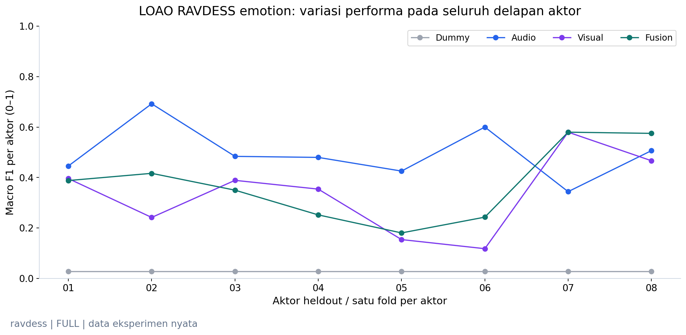
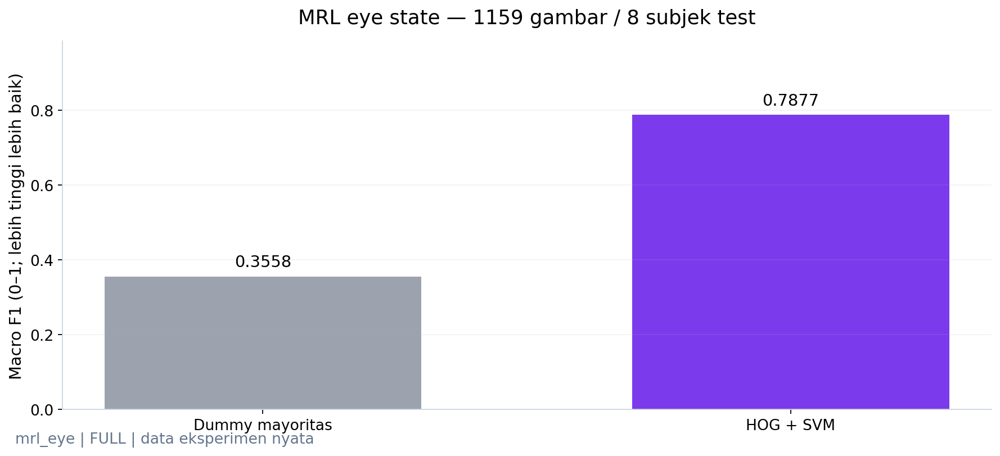
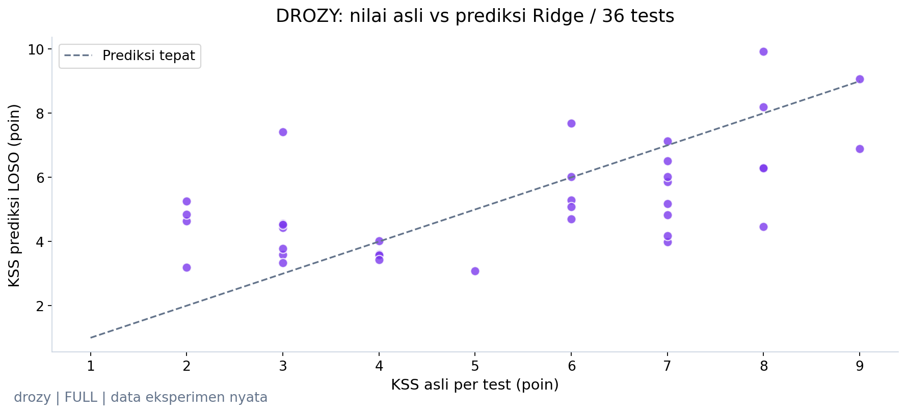
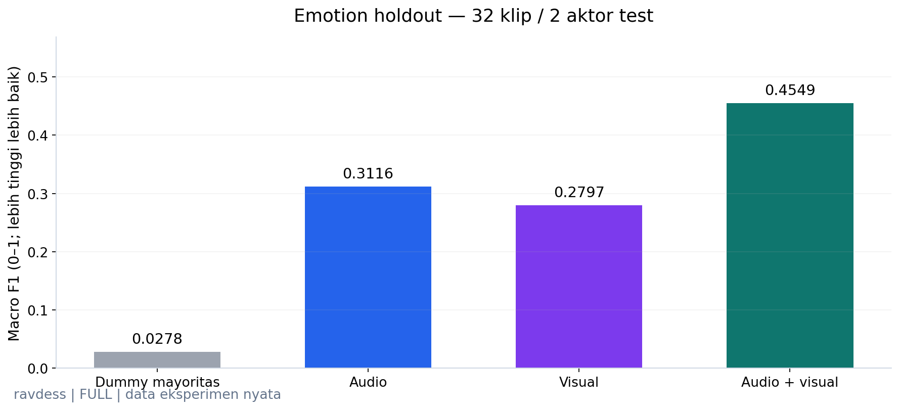

# Pembaruan publikasi media berizin — 23 Oktober 2026

Pengguna telah merevisi preferensi sebelumnya dan mengizinkan repo publik memuat contoh media smoke test.
[Galeri media asli](../assets/demo_media/README.md) kini memuat delapan asset kecil (total 11.188.079 byte, sekitar 10,67 MiB):
source WAV Predi-COVID yang isinya tidak diubah, clean mono 16 kHz, radio20 dari recording yang sama, tiga grafik waveform/STFT/PSD,
serta satu genuine paired AV RAVDESS beserta frame JPEG sekitar 0,5 detik.
Pemilihan tetap recording test pertama menurut sample ID, identik dengan demo sebelumnya, bukan berdasarkan skor terbaik.

**Predi-COVID:** CC BY4.0; kredit Abir Elbéji et al.(2022),[sumber](https://doi.org/10.5281/zenodo.5937844).
**RAVDESS:** CC BY-NC-SA4.0; kredit Steven R. Livingstone dan Frank A. Russo(2018),[sumber](https://doi.org/10.5281/zenodo.1188976).
Source, perubahan, license per asset,checksum dan run ID tercatat dalam [manifest publikasi](notebook_v3_media_publication.json).
Dua player Predi-COVID yang bytes-nya cocok whitelist boleh tertanam pada notebook audio. File WAV/MP4 menyediakan fallback download jika renderer GitHub menyembunyikan HTML player.

Raw ATCOSIM tetap tidak dipublikasikan: [technical report](https://www2.spsc.tugraz.at/databases/ATCOSIM/DOC/atcosim_report.pdf) melarang redistribusi kepada pihak ketiga.
Raw/gambar DROZY memerlukan [izin tertulis dan ketentuan penampilan](https://orbi.uliege.be/bitstream/2268/191620/5/DROZY-LicenseAgreement-20180718.pdf).
Hak redistribusi media MRL/CogBeacon belum terverifikasi. Izin pengguna atas repo tidak mengubah ketentuan pemilik dataset tersebut.

**Tidak ada training atau download dataset baru.** Semua code cells penelitian pada ketiga notebook identik dengan versi FULL sebelumnya;
perubahan notebook hanya Markdown/publikasi output. Source hash FULL lama tetap dicatat, sedangkan source hash DEMO terbaru mencakup Markdown yang diperbarui.
QA memverifikasi original FULL source hash, exact scientific code identity, preprocessing train-only, 145 checkpoint / 154 replays, asset checksums dan whitelist audio bytes.
82 tests lulus, termasuk penolakan payload/audio/kode tidak sesuai whitelist. Mode DEMO tanpa raw source tetap diuji pada ketiga notebook.
Kebijakan blanket "semua media hanya lokal" dalam laporan historis di bawah kini mempunyai pengecualian spesifik ini; seluruh skor, model dan completed runs tetap dipertahankan.

---

# Notebook-first v3 — three-track feasibility dan input model transparan

Pembaruan **23 Oktober 2026 UTC**, branch `feat/notebook-first-v3`, [PR #1](https://github.com/maulnite/atc-fatigue-research/pull/1).
Tetap tepat tiga notebook utama. Bagian ini adalah hasil terkini; laporan sebelumnya dipertahankan utuh di bawah.
**Fatigue klinis/unwell, eye state, KSS sleepiness dan emotion tetap target berbeda. Performa fatigue ATC multimodal belum diukur.**

## Implemented and verified

- **[01 — Audio](../notebooks/v3/01_audio_analysis.ipynb):** raw/processed ATCOSIM lokal, STFT/log-Mel/MFCC, kelompok 88 eGeMAPS + 26 MFCC, schema 114 aktual, contoh nilai raw/scaled, beberapa row `X_train`, bentuk `X_train/X_validation/X_test` dan `y`. Predi-COVID memakai target native fatigue/unwell dan participant split tetap. Tambahan radio study menjalankan actual extraction/training/evaluation, confusion, recall/precision, ROC/AP, feature shift serta error seluruh peserta.
- **[02 — Visual](../notebooks/v3/02_visual_analysis.ipynb):** raw eye→resize→HOG lokal, input 756D actual dan prediksi benar/salah deterministik. Landmark 68→enam titik→EAR lokal, diagram EAR parametrik sintetis, events/coverage/zoom, window→test 10D, raw/scaled actual Ridge input, original KSS prediction/error serta ablation 14 LOSO. Panel landmark sebelum/sesudah memakai sumbu dan aspect ratio yang sama.
- **[03 — Fusion](../notebooks/v3/03_multimodal_fusion.ipynb):** metadata genuine paired AV, durasi/offset/availability, 114 fitur audio + 3.528 HOG + 2 masks = 3.644 input, raw/scaled matrices, schema lengkap, deterministic 9-step prediction walkthrough dan minimal satu kegagalan fusion. Semua 32 test recording terlihat pada error map. Baseline, masking ablation dan LOAO lama tetap tersedia.
- **Privasi:** player clean/radio dan media sumber hanya opt-in lokal. Semua cell privat dan embedded audio/video tanpa tag disanitasi pada salinan publik; evidence asli tetap lokal. DEMO publik memuat cache dan menghitung inference, tanpa membaca raw media atau mengklaim training/ekstraksi baru.
- **Reproducibility:** run append-only, config/seed/environment/source hashes, split/source labels, checkpoint reload dan artifact integrity. Semua skor historis direproduksi; model/checkpoint/cache lama tidak ditimpa. Tidak ada download baru, GPU atau perubahan shared environment.

**Bagaimana menelusuri input:** mulai dari source metadata/label, periksa temporal/image representation, lihat feature names/values,
bandingkan raw terhadap transformed rows dari checkpoint training-only, kemudian cocokkan prediksi terhadap ground truth.
Schema ID, filename/path, target, timestamp dan demografi tidak digunakan sebagai prediktor.
Input cache tetap biometrik dan tidak dipublikasikan penuh; preview terbatas sengaja cukup untuk pendidikan.

**Validasi final:** 79 tests lulus; Ruff dan dependency check lulus. Sembilan acceptance executions (3 notebook × FULL/DEMO publik tanpa raw/DEMO privat) memakai fresh kernels dan source hash yang sama. Ada 69 grafik publik dan 9 grafik privat lokal; 50 topik grafik sebelumnya tetap tersedia, serta 85 PNG publik lama identik. Seluruh 145 checkpoint unik pada registry aktif diverifikasi dalam 154 replay-evaluations (artefak radio sama dipakai pada beberapa kondisi); metrik/ROC/AP dihitung ulang dari prediksi. Median, mean, variance dan jumlah training rows diverifikasi terhadap training fold masing-masing. Sebanyak 3.284 berkas terlindungi dan historical metrics tidak berubah. Peringatan tests hanya 14 deprecation Matplotlib/Pyparsing, bukan kegagalan training.

Semua raw audio/video/eye images/source-derived plots tetap lokal. Output publik berisi 0 embedded audio/video dan 0 private paths. Clone GitHub dapat menampilkan seluruh hasil; menjalankan DEMO tetap memerlukan model/feature cache lokal yang sah.

## Audio: clean versus radio-channel simulation

Dataset lokal berizin tetap **207 recording / 120 peserta**, terdiri dari 129 train / 36 validation / 42 test,
dengan 76/20/24 peserta yang tidak overlap. Test 24 well + 18 fatigue/unwell.
Clean berarti sebelum simulasi tambahan, bukan jaminan suara bebas noise.

| Komponen simulasi | Parameter yang benar-benar digunakan |
| :--- | :--- |
| Preprocessing | Canonical mono 16 kHz; source 8 kHz tidak mendapat informasi frekuensi baru |
| Filter | Butterworth SOS order 4, 300–3400 Hz, forward-backward offline/acausal; effective magnitude squared |
| Gain | −3 dB; joint peak attenuation bila perlu menjaga peak ≤0,98 |
| Noise | Gaussian band-limited; primary 20 dB dan exploratory stress 10 dB |
| Seed | SHA-256 dari radio-v1, seed 42 dan sample ID; tidak bergantung label/split/order |
| SNR | Diukur terhadap filtered/gained reference; bukan estimasi noise asli |
| Codec/distorsi | Tidak disimulasikan; tidak mengklaim radio receiver ATC tervalidasi |

Dua player lokal memakai recording test deterministik yang **sama** dan `normalize=False`.
Waveform/STFT sejajar memakai sumbu dan color reference sama; PSD before/after ditampilkan lokal dengan satuan dB amplitudo²/Hz.
Publik memakai respons matematis filter, ilustrasi energi sintetis berlabel, dan ringkasan quality/feature/evaluation yang aman.
Tidak ada derivative WAV yang disimpan atau masuk Git. QC 414 transformasi memenuhi SNR 20/10 dB dengan error maksimum
**1.26e-08 dB**, clipping seluruh derivative 0.

Split peserta dibekukan **sebelum augmentation**. Hanya 129 training source recording diberi versi radio20,
menghasilkan 258 training rows tetapi tetap 76 orang. Validation/test channel adalah repeated measurements recording sama,
bukan tambahan observasi independen. Model tetap Dummy, Logistic C=1 dan Linear SVM C=1; tidak ada tuning pada test.
Enam checkpoint menghasilkan 15 kombinasi evaluasi (tiga primer dan dua stress × tiga model).

| Train → test | Model | Macro F1 | Balanced accuracy | Recall fatigue/unwell | ROC-AUC | Average precision |
| :--- | :--- | ---: | ---: | ---: | ---: | ---: |
| clean → clean | dummy_majority | 0.3636 | 0.5000 | 0.0000 | 0.5000 | 0.4286 |
| clean → clean | logistic_c1 | 0.4857 | 0.4861 | 0.3889 | 0.5648 | 0.4880 |
| clean → clean | linear_svm_c1 | 0.5258 | 0.5278 | 0.3889 | 0.5764 | 0.4833 |
| clean → radio20 | dummy_majority | 0.3636 | 0.5000 | 0.0000 | 0.5000 | 0.4286 |
| clean → radio20 | logistic_c1 | 0.6298 | 0.6458 | 0.3333 | 0.6852 | 0.6889 |
| clean → radio20 | linear_svm_c1 | 0.5758 | 0.5764 | 0.4444 | 0.6088 | 0.5297 |
| aug20 → radio20 | dummy_majority | 0.3636 | 0.5000 | 0.0000 | 0.5000 | 0.4286 |
| aug20 → radio20 | logistic_c1 | 0.5758 | 0.5764 | 0.4444 | 0.6157 | 0.5367 |
| aug20 → radio20 | linear_svm_c1 | 0.4815 | 0.4931 | 0.2778 | 0.5417 | 0.4644 |
| clean → radio10 | dummy_majority | 0.3636 | 0.5000 | 0.0000 | 0.5000 | 0.4286 |
| clean → radio10 | logistic_c1 | 0.5073 | 0.5625 | 0.1667 | 0.6042 | 0.5571 |
| clean → radio10 | linear_svm_c1 | 0.5654 | 0.5694 | 0.3889 | 0.5741 | 0.5244 |
| aug20 → radio10 | dummy_majority | 0.3636 | 0.5000 | 0.0000 | 0.5000 | 0.4286 |
| aug20 → radio10 | logistic_c1 | 0.4457 | 0.5139 | 0.1111 | 0.6296 | 0.5348 |
| aug20 → radio10 | linear_svm_c1 | 0.4590 | 0.5000 | 0.1667 | 0.6042 | 0.5405 |

**Hasil yang tidak sesuai dugaan:** Logistic clean→radio20 justru memiliki pooled Macro F1 lebih tinggi daripada clean→clean,
tetapi recall positif turun 7/18 → 6/18. Matrix clean `[[14,10],[11,7]]`, radio20 `[[23,1],[12,6]]`.
Augmentation menjadi `[[17,7],[10,8]]`: recall positif 8/18 naik, tetapi false alarms bertambah dan Macro F1 turun menjadi 0,5758.
Jadi kenaikan satu metrik tidak berarti seluruh kelas terbantu. Augmentation belum memberikan keuntungan konsisten.
Pada 10 dB recall positif Logistic hanya 3/18 (clean train) atau 2/18 (augmented train).
AP adalah average precision, bukan luas trapezoid PR. SVM margin/Logistic scores bukan tingkat fatigue yang terkalibrasi.

Feature shift terbesar pada test adalah `egemaps__logRelF0-H1-A3_sma3nz_stddevNorm`: rerata absolute shift 41,67 z pada scaler training clean (raw test mean 0,363→5,278; training scale 0,118). Descriptor yang dinormalisasi ini sensitif terhadap perubahan kanal. Angka z besar menunjukkan distribution shift input, bukan peningkatan fatigue atau feature importance. Status benar/salah MRL mengikuti label resmi dataset; contoh privat bukan pengganti validasi manual seluruh anotasi.

Ini uji **channel robustness pada populasi klinis**. Penyakit, perangkat, demografi, bahasa dan label fatigue **atau unwell**
masih menjadi confound. Tidak ada bukti transfer ke occupational fatigue operator atau kanal radio ATC yang sebenarnya.
Tidak ada confidence interval yang memperlakukan recording dari orang sama sebagai independen.



**Interpretasi:** Ketiga kondisi primer memakai 42 recording test / 24 peserta yang sama; augmentation tidak konsisten meningkatkan Macro F1 atau balanced accuracy. Sumber run `20261023T105608840284Z_seed42_0d3b34`.


## Visual: perbandingan fitur pada label KSS yang sama

MRL tetap eye-state classification: 5.285 gambar / 37 subjek, 1.159 gambar / 8 subjek test;
SVM Macro F1 **0,7877**, balanced accuracy **0,7872**, Dummy Macro F1 **0,3558**.
MRL tidak memiliki urutan timestamp/FPS yang terverifikasi pada subset, sehingga tidak digunakan menghitung durasi blink.

DROZY tetap **360 windows → 36 original tests / 14 subjek**. Sebanyak 348 window tersedia menjadi input agregasi,
bukan 348 label KSS independen. Satu test memiliki 10 fitur (mean/std dari EAR mean/std, blink rate/duration dan operational closure fraction).
Preprocessing di-fit ulang pada training setiap LOSO fold; KSS adalah sleepiness subjektif, bukan fatigue keseluruhan.
Threshold EAR 0,21, gap 150 ms, blink 50–500 ms, sustained closure ≥500 ms dan coverage ≥80% tetap engineering definitions.
Operational PERCLOS adalah sustained-closure duration / valid duration, belum validasi kelopak 80% tertutup.

| Kelompok / Ridge alpha1 kecuali Dummy | MAE KSS | RMSE KSS | Subject-macro MAE |
| :--- | ---: | ---: | ---: |
| blink_only | 1.5362 | 1.9033 | 1.5422 |
| closure_only | 1.9109 | 2.1040 | 1.9552 |
| combined | 1.4544 | 1.8170 | 1.4405 |
| dummy_mean | 2.0519 | 2.2704 | 2.1082 |
| ear_only | 1.3508 | 1.6524 | 1.3571 |

**EAR-only lebih rendah errornya daripada combined pada protokol ini.** Seluruh 70 checkpoint (5 model × 14 fold) memakai fold yang sama;
fitur tidak ditambah kompleksitas untuk mengejar score. Ini perbandingan exploratory, bukan pemilihan model final dari holdout.
Model combined identik dengan benchmark Ridge sebelumnya: MAE 1,4544 versus Dummy 2,0519.
Ridge tidak dibatasi ke 1–9; prediksi di luar rentang KSS tetap ditampilkan, tidak di-clip agar skor terlihat lebih baik.
Variasi/error per subjek, missing handling dan penghitungan satu window dapat diperiksa pada notebook.



**Interpretasi:** Menambahkan blink/closure tidak otomatis memperbaiki KSS prediction: EAR-only MAE 1,351, combined 1,454 poin; 14 LOSO folds identik. Sumber run `20261023T110208961056Z_seed42_d8ef0c`.


## Fusion: engineering berhasil; keuntungan performa belum konsisten

Model menerima fitur aktual dari container AV yang sama, bukan pairing lintas dataset.
Audio 114D, HOG appearance 3.528D, masks 2D dan fusion 3.644D dibandingkan pada split/label emotion yang sama.
Historical train hanya 64 recording / 4 aktor; test 32 recording / 2 aktor, 4 per emotion.
Rasio fusion/train 56,94 fitur per recording memperjelas risiko overfitting.
Train male-only dan evaluasi female-only menurut metadata masih confound historis.

| Model | Historical fixed test Macro F1 | LOAO exploratory pooled Macro F1 |
| :--- | ---: | ---: |
| Dummy |0,0278|0,0278|
| Audio-only |0,3116|0,5452|
| Visual-only |0,2797|0,4071|
| Early fusion |0,4549|0,4268|

LOAO 8 fold menahan satu aktor, train 112 / test 16 per fold; zero actor overlap dan fixed C=1.
Fusion mengungguli audio pada **2/8 aktor**, bukan konsisten. Populasi/training size berbeda dari split historis;
tabel bukan klaim kenaikan langsung antarprotokol. Aktor sudah dipakai pengembangan: LOAO bukan test konfirmatori baru.
Masking modality pada inference bukan training agar model robust terhadap modality hilang.
Walkthrough deterministik dan seluruh error map memperlihatkan kesepakatan model dapat tetap salah.
HOG 2 FPS bukan blink/PERCLOS. Tidak ada skor fatigue ATC dari emotion.



**Interpretasi:** Actual transformed X_train menampilkan subset 16 kolom dari audio, visual dan fusion; imputation/scaling berasal dari 64 training clips saja. Sumber run `20261023T104859625424Z_seed42_cce30b`.


## Status akses, implemented but not executed, blocked dan future research

| Kategori | Status transparan |
| :--- | :--- |
| Implemented and verified | Tiga track, actual input views, radio training/evaluation, visual ablation, source-private players/previews, FULL/DEMO, QA dan publikasi aman sesuai validation JSON |
| Implemented but not executed | Tidak ada jalur inti yang sengaja ditinggalkan tanpa pengujian. FULL hanya subset lokal berizin; seluruh corpus tambahan belum dijalankan |
| Not implemented / blocked | Supervised CogBeacon frame/window fatigue: counter event tidak memberi ground truth yang cukup; clock alignment dan selisih 77 sesi / 20 ID vs paper 76/19 belum tuntas |
| Not implemented / blocked | Multimodal ATC fatigue benchmark: belum ada paired ATC AV dengan label sah; IEEE audio fatigue masih belum tersedia |
| Future research | External subject-independent validation, kontrol confound klinis/perangkat/bahasa, measured radio channels, label protocol bersama Prof, kalibrasi EAR/PERCLOS, dan optional fixed late fusion tanpa test tuning |

Predi-COVID sudah tersedia lokal dengan izin sebelumnya, CC BY 4.0, checksum MD5 penerbit / SHA-256 diverifikasi;
tidak menggunakan COVID symptomatic label sebagai pengganti fatigue.
CogBeacon di-audit ulang dari seluruh 68.118 NPZ / 6.972 rounds, 79 button presses; sampling 2 FPS tidak mendukung blink/PERCLOS.
Tidak ada binary fatigue classifier yang dipaksakan. Tidak ada download tambahan pada pekerjaan ini.

## Run IDs, reproduksi dan validation evidence

| Eksperimen aktif | Run ID baru |
| :--- | :--- |
| atcosim_audio | `20261023T105347534495Z_seed42_49cb09` |
| drozy_kss | `20261023T110137480062Z_seed42_566711` |
| mrl_eye_state | `20261023T110123270660Z_seed42_29f903` |
| ravdess_emotion | `20261023T104859625424Z_seed42_cce30b` |
| cogbeacon_audit | `20261023T110223847434Z_seed42_d2fddb` |
| ravdess_emotion_loao | `20261023T105052302183Z_seed42_0d6280` |
| predi_covid_fatigue | `20261023T105402224766Z_seed42_880107` |
| predi_covid_radio | `20261023T105608840284Z_seed42_0d3b34` |
| drozy_feature_ablation | `20261023T110208961056Z_seed42_d8ef0c` |

[Registry](notebook_v3_runs.json) menyimpan histori lengkap. `runs/` dan full biometric caches/checkpoints tetap lokal.
Perintah dan pengaturan media ada pada [README tiga notebook](../notebooks/v3/README.md).
[Validation JSON](notebook_v3_validation.json) memuat hasil final source/metrics/checkpoint replay, privacy, execution matrix,
preservation checks dan daftar grafik publik. Seluruh grafik tambahan diperiksa visual: font, sumbu, colorbar, legend, overlap dan kejujuran skala.

Saat integrasi, fresh-kernel Run All menemukan satu cell PSD diletakkan sebelum konfigurasi Predi-COVID.
Urutannya diperbaiki; evidence gagal dipertahankan lokal. Final FULL/DEMO dijalankan ulang setelah perbaikan,
termasuk narasi sumber cache dan penyamaan sumbu geometri landmark.

---

# Snapshot enhancement sebelumnya — 22 Oktober 2026

# Notebook-first v3 — enhancement incremental terverifikasi

Pembaruan **22 Oktober 2026 (UTC)** pada branch `feat/notebook-first-v3`, untuk [PR #1](https://github.com/maulnite/atc-fatigue-research/pull/1).
**Tetap tepat tiga notebook utama** pada `notebooks/v3/`. Tidak ada versi/folder baru, merge ke main, penghapusan hasil lama atau perubahan shared environment.
Bagian awal ini adalah status enhancement terbaru; snapshot implementasi awal dipertahankan utuh setelah pemisah di bawah.

## Implemented and verified

| Notebook yang diperbarui langsung | Cells / code | Grafik publik |
| :--- | ---: | ---: |
| [01_audio_analysis.ipynb](../notebooks/v3/01_audio_analysis.ipynb) | 42 / 26 | 14 |
| [02_visual_analysis.ipynb](../notebooks/v3/02_visual_analysis.ipynb) | 48 / 33 | 21 |
| [03_multimodal_fusion.ipynb](../notebooks/v3/03_multimodal_fusion.ipynb) | 39 / 24 | 15 |

Total **50 grafik publik + 4 grafik ATCOSIM asli lokal**, dengan tema audio biru, visual ungu, fusion teal dan baseline abu-abu.
Seluruh 35 grafik sebelumnya tetap relevan dan dipertahankan; tambahan 15 grafik publik memperluas analisis.
Grafik memiliki *Yang terlihat / Artinya / Perlu diingat* dan jejak run. Diagram konseptual dan ilustrasi sintetis tidak dipakai sebagai data training.

- **Audio:** metadata/dtype/kanal/kualitas WAV aktual, waveform sebelum/sesudah mono-resampling, STFT, log-Mel, MFCC temporal,
  bukti kecocokan MFCC dengan extractor canonical, serta pemetaan 88 eGeMAPS + 26 MFCC = 114 fitur per utterance.
  Empat representasi sumber hanya aktif melalui opt-in lokal; salinan publik mempertahankan ilustrasi sintetis berlabel.
  Ditambahkan audit, EDA, QC, subject split, training Dummy/Logistic/Linear SVM dan error analysis Predi-COVID.
- **Visual:** seluruh MRL/DROZY tetap tersedia, ditambah zoom dua kandidat closure selesai paling awal berdurasi 50–500 ms,
  threshold, timestamp/durasi, serta penanganan gap/invalid. CogBeacon dianalisis deskriptif dari seluruh NPZ/CSV,
  tanpa mengubah counter tombol menjadi label frame fatigue.
- **Fusion:** audit setiap aktor/split/demografi/kelas/support; rasio dimensi fitur terhadap 64 recording train;
  precision/recall/F1/support, error per aktor, delapan contoh test pertama yang dipilih deterministik,
  LOAO actor-independent delapan fold dengan 32 checkpoint, variasi/delta per aktor dan confusion matrix pooled.
  Benchmark historis serta inference masking ablation tetap dipertahankan.



**Interpretasi:** DROZY: dua kandidat blink selesai paling awal sesuai aturan durasi; belum validasi fisiologis manual. Sumber run `20261022T133744544508Z_seed42_0e3eaa`.

## Hasil aktual Predi-COVID: sinyal klinis masih lemah

[Zenodo](https://zenodo.org/records/5937844) terbuka CC BY 4.0; data dapat diunduh dengan sah.
Subset berizin **207 WAV / 120 peserta**, seed 42, membaca teks saja, maksimal dua rekaman paling awal per peserta,
tanpa seleksi berdasarkan label atau skor model. Payload audio **338,02 MiB**, di bawah batas izin 384 MiB / workspace tambahan 1 GiB.
Seluruh MD5 penerbit dan SHA-256 diverifikasi. Semua 207 quality flags `ok`, 114 fitur finite, clipping terukur 0.
Sumber mono 8/44,1 kHz; durasi 18.866–49.922 detik.
Resampling tidak menghapus device/domain confound.

Label 0 berisi **121 rekaman** dan label 1 **86**. Sebanyak 87 peserta memiliki dua rekaman, 33 satu rekaman,
dan 14 peserta menunjukkan perubahan label dalam subset. Label adalah keadaan klinis hari yang sama:
well versus **fatigued atau unwell**, sesuai [publikasi](https://doi.org/10.1136/bmjopen-2022-062463).
Tidak identik dengan occupational fatigue, dan tidak melabeli perubahan di dalam ujaran.

Split tetap: **129 rekaman / 76 peserta train**,
**36 / 20 validation**,
**42 / 24 test**. Semua hari seorang peserta tetap bersama;
overlap subjek/checksum lintas split nol. Test memiliki 24 label well dan 18 fatigue/unwell.
Median/scaler di-fit hanya pada train. C=1, class weight balanced, seed dan algoritma ditetapkan sebelum evaluasi;
validation ditampilkan tetapi tidak dipakai tuning.

| Model | Test Macro F1 | Balanced accuracy | Accuracy |
| :--- | ---: | ---: | ---: |
| dummy_majority | 0.3636 | 0.5000 | 0.5714 |
| logistic_c1 | 0.4857 | 0.4861 | 0.5000 |
| linear_svm_c1 | 0.5258 | 0.5278 | 0.5476 |

Logistic memiliki recall well **0,5833**, fatigue/unwell **0,3889**, matrix `[[14,10],[11,7]]`.
Linear SVM memiliki recall well **0,6667**, fatigue/unwell **0,3889**; Dummy tidak pernah memprediksi kelas 1.
Karena itu kenaikan Macro F1 perlu dibaca bersama balanced accuracy yang masih dekat 0,5, bahkan Logistic di bawah Dummy.
Hasil belum mendukung biomarker kuat atau generalisasi ke ATC. Error seluruh 24 peserta dan strata perangkat/demografi ditampilkan;
tidak ada clip-level confidence interval atau pemilihan contoh berdasarkan skor terbaik.

Confound belum teratasi: COVID/penyakit, demografi, bahasa, perangkat, hari, dan protokol membaca.
Bahasa per recording serta timestamp respons label terhadap recording tidak lengkap pada metadata yang digunakan.
Lihat [audit dataset](fatigue_dataset_audit.json) dan [dokumentasi sumber](../docs/datasets.md).



**Interpretasi:** Predi-COVID: Macro F1 perlu dibaca bersama balanced accuracy yang dekat 0,5; 42 recording /24 peserta test. Sumber run `20261022T133521652181Z_seed42_d98d66`.

## Hasil aktual CogBeacon: deskriptif, tanpa classifier

Tiga arsip kecil GitHub berhasil diperoleh dan Git blob SHA diverifikasi; EEG tidak diunduh.
Audit penuh: **77 sesi / 20 ID numerik, 68.118 NPZ, 6.972 ronde, 79 tekan pada 79 ronde**.
Semua NPZ memiliki 140 angka finite menurut schema audit; alignment ronde label/performa valid.
Sumber [README](https://github.com/MikeMpapa/CogBeacon-MultiModal_Dataset_for_Cognitive_Fatigue)
dan [paper](https://www.mdpi.com/2227-7080/7/2/46) menyebut 76 sesi / 19 peserta.
Perbedaan ini belum terselesaikan; 20 ID numerik tidak diklaim sebagai 20 peserta terverifikasi.

Akhiran `b` adalah hari kedua orang yang sama. CSV target berupa **counter tombol kumulatif per ronde**;
selisih counter memberi event baru, tetapi tidak ada event bukan kelas non-fatigue.
Indeks frame reset per ronde, clock absolut belum terverifikasi, dan `Time` adalah respons tugas.
Nominal **2 FPS tidak mendukung blink duration/PERCLOS**. Tidak ada fatigue classifier atau skor palsu.
MIT pada LICENSE menyebut software dan paper menyatakan persetujuan berbagi data; output publik hanya agregat,
tidak mencakup koordinat wajah atau redistribusi biometrik.

## RAVDESS: fusion belum konsisten mengungguli audio

Split historis tetap **64 / 32 / 32** recording dari **4 / 2 / 2** aktor, train male-only dan evaluasi female-only
menurut kategori metadata sumber. Tiap aktor 16 klip; test historis hanya **4 klip per emotion**.
Fitur audio 114, visual 3.528, fusion 3.644: rasio terhadap 64 training recording = **1,781 / 55,125 / 56,938**.
Dimensi tinggi terhadap contoh menambah risiko overfitting; standardisasi/regularisasi tidak menambah aktor baru.

LOAO menahan satu dari delapan aktor, melatih pada tujuh aktor/112 klip, menguji 16 klip.
Setiap fold memiliki delapan emotion, kedua kelompok metadata pada train, dan zero actor overlap train/test.
Dummy dan tiga model Logistic C=1 memakai fold dan populasi identik, preprocessing train-only, tanpa test tuning.
Ini **exploratory/sensitivity analysis** karena seluruh aktor pernah dipakai dalam pengembangan.

| Model | Historis: Macro F1 / 32 klip, 2 aktor | LOAO exploratory: pooled Macro F1 / 128 klip, 8 aktor |
| :--- | ---: | ---: |
| dummy_majority | 0.0278 | 0.0278 |
| audio_only | 0.3116 | 0.5452 |
| visual_only | 0.2797 | 0.4071 |
| audio_visual | 0.4549 | 0.4268 |

**Jawaban:** fusion unggul pada split historis, tetapi LOAO memberi audio-only lebih tinggi daripada fusion.
Fusion hanya melampaui audio pada **2/8 aktor**, dan visual pada **4/8**.
Macro F1 fusion per aktor: mean **0.3731**, SD **0.1487**,
rentang **0.1806–0.5798**.
Audio per aktor: mean **0.4972**, rentang **0.3440–0.6923**.
Variasi ini deskriptif; tidak ada bootstrap klip yang menganggap rekaman aktor sama independen, CI atau klaim signifikansi.

Skor historis dan LOAO menggunakan populasi/ukuran training berbeda; selisih keduanya bukan efek peningkatan metode.
Keunggulan fusion tidak boleh digeneralisasi dari split lama. HOG 2 FPS adalah appearance, target emotion,
dan masking saat inference bukan training robust terhadap modality hilang. **Fatigue ATC tetap belum diukur.**



**Interpretasi:** RAVDESS LOAO exploratory: seluruh delapan aktor ditampilkan, bukan contoh aktor terbaik. Sumber run `20261022T132032729881Z_seed42_20a3fa`.

## Run FULL terpilih dan provenance

| Eksperimen | Run ID completed | Target | Baris / ID subjek |
| :--- | :--- | :--- | ---: |
| `atcosim_audio` | `20261022T133504291481Z_seed42_84e529` | N/A — deskriptif | 100 / 1 |
| `predi_covid_fatigue` | `20261022T133521652181Z_seed42_d98d66` | clinical_fatigue_binary | 207 / 120 |
| `mrl_eye_state` | `20261022T133730709109Z_seed42_1a323e` | eye_state | 5285 / 37 |
| `drozy_kss` | `20261022T133744544508Z_seed42_0e3eaa` | KSS | 36 / 14 |
| `cogbeacon_audit` | `20261022T133828759667Z_seed42_6cfc97` | N/A — deskriptif | 77 / 20 |
| `ravdess_emotion` | `20261022T131839829341Z_seed42_49ba0e` | emotion | 128 / 8 |
| `ravdess_emotion_loao` | `20261022T132032729881Z_seed42_20a3fa` | emotion | 128 / 8 |

Setiap run baru menyimpan config, environment, checksum kode/input, hash source notebook, feature schema,
split/fold, model, prediksi, metrik, QC, grafik/captions, log dan integrity hashes.
Predi-COVID mencatat protokol fixed-model; LOAO mencatat parent feature run dan baseline historis.
CogBeacon memiliki audit/arsip checksum dan tidak memiliki model supervised.
Manifest mencatat `git_dirty=true` dan base commit `22f5472c4561c36e14f5740629d5e6cccc57fbdd`;
checksum kode serta source cells merekam perubahan aktual sebelum commit final, bukan menganggap base commit memuat enhancement.

## Fresh-kernel execution dan validasi

| Notebook | FULL session UTC | Durasi (s) | Grafik |
| :--- | :--- | ---: | :--- |
| 03_multimodal_fusion.ipynb | `20261022T131734Z_20fbda` | 122.636 | 15 lokal / 15 publik |
| 01_audio_analysis.ipynb | `20261022T133502Z_994582` | 145.293 | 18 lokal / 14 publik |
| 02_visual_analysis.ipynb | `20261022T133502Z_994582` | 63.376 | 21 lokal / 21 publik |

| Notebook | DEMO publik session UTC | Durasi (s) | Grafik publik |
| :--- | :--- | ---: | ---: |
| 01_audio_analysis.ipynb | `20261022T133933Z_77a229` | 10.742 | 14 |
| 02_visual_analysis.ipynb | `20261022T133933Z_77a229` | 13.312 | 21 |
| 03_multimodal_fusion.ipynb | `20261022T133933Z_77a229` | 14.282 | 15 |

Seluruh eksekusi akhir passed dan tidak memiliki output error; source cells konsisten dengan FULL terpilih.
FULL menghitung fitur dan training nyata sesuai subset lokal berizin; DEMO memakai cache tervalidasi dan inference checkpoint sungguhan.
Empat grafik audio asli diuji melalui FULL privat dan DEMO privat, lalu seluruh output cell private-media dibuang dari salinan publik saja.
Sumber audio aktual tetap diproses pada default DEMO untuk metadata/fitur; plot sumber hanya lokal.

- **71 tests passed**, Ruff dan pip check lulus; 14 deprecation warnings dependensi plotting pytest dipertahankan tanpa mengubah shared environment.
- **69 checkpoint direplay**, prediksi dan metrik utama/confusion matrices dihitung ulang dan cocok: 2 MRL + 28 KSS + 4 RAVDESS historis + 32 LOAO + 3 Predi-COVID.
- Split subject/actor-disjoint, checksum duplikat lintas split, target/label publisher, train-only preprocessing, source hashes dan artifact integrity diperiksa.
- Metrik MRL/KSS/RAVDESS historis direproduksi hingga toleransi 1e-12; semua hasil canonical/checkpoint lama utuh.
- **1.367 berkas pre-enhancement identik checksum**, termasuk completed runs, model, manifest/cache, canonical metrics dan lima notebook legacy.
- Seluruh **50 grafik publik + 4 grafik privat** diperiksa secara visual: keterbacaan, label/satuan, skala, legend, colorbar, dan interpretasi.
  Review memperbaiki legend klinis yang sempat terbawa dari helper MRL, posisi legend EAR/aktor, judul panel QC dan footer.
- Pemeriksaan MIME, HTML/media, source paths dan tagged private outputs lulus. Hanya PNG/tabel agregat yang sudah ditinjau dipublikasikan.

Dua eksekusi perantara gagal dan evidence-nya dipertahankan: satu source-hash guard menolak perubahan source saat proses berjalan,
satu audio run berhenti sebelum training karena indentasi cell. Keduanya diperbaiki dan dijalankan ulang ke direktori baru;
runner kini memeriksa sintaks sebelum eksperimen mahal. Tidak ada skor dari percobaan gagal yang dipakai sebagai hasil.

## Implemented but not executed

Jalur utama ketiga notebook dan tujuh jenis run sudah dieksekusi.
Utility persiapan `12_prepare_predi_subset.py` diuji untuk reproduksi pemilihan label-blind,
tetapi jalur unduhan dari checkout kosong melalui utility tersebut belum diulang: unduhan aktual dilakukan sekali dengan downloader berlog dan batas yang disetujui.
Unduhan ulang tidak diperlukan untuk memvalidasi eksperimen yang memakai seluruh WAV terverifikasi.

## Not implemented / blocked

- Classifier CogBeacon: definisi label window, clock absolut dan discrepancy peserta belum tervalidasi; sengaja tidak dipaksakan.
- Benchmark paired multimodal fatigue ATC: belum ada data/protokol ground truth berpasangan yang sah; akses IEEE juga belum terverifikasi tersedia.
- Seluruh 3.544 audio Predi-COVID tidak diunduh; eksperimen FULL berlaku untuk subset 207 rekaman yang diizinkan.
- Publikasi waveform/spectrogram/MFCC sumber ATCOSIM tidak diaktifkan; empat grafik ini hanya tersedia pada evidence privat lokal.

## Future research

Preregistrasikan target fatigue dan protokol waktu bersama Prof; audit label klinis/unwell dan confound perangkat/bahasa,
lalu gunakan kohort eksternal dengan split peserta independen. Klarifikasi CogBeacon kepada penulis sebelum membentuk window labels.
Kalibrasi EAR/closure dengan anotasi manual dan sampling memadai, serta kumpulkan pasangan ATC audio-video sinkron berizin.
Validasi eksternal dan training missing-modality robustness merupakan studi baru, bukan klaim dari score emotion saat ini.

## Reproduksi dan publikasi

```bash
.venv/bin/python scripts/10_execute_notebook_v3.py --mode FULL
.venv/bin/python scripts/10_execute_notebook_v3.py --mode DEMO
# Hanya untuk sesi audio lokal berizin; runner menyanitasi salinan publik.
.venv/bin/python scripts/10_execute_notebook_v3.py --mode DEMO --notebook 01_audio_analysis.ipynb --private-media
.venv/bin/python scripts/11_validate_notebook_v3.py
.venv/bin/python -m pytest -q
.venv/bin/ruff check src tests scripts
.venv/bin/python -m pip check
```

Gunakan `.venv` proyek dan siapkan dataset/model lokal secara sah; clone GitHub hanya membawa notebook/output aman.
Tidak ada paket shared diganti, GPU dipakai, media/raw dataset/cache/model diunggah, atau run completed ditimpa.
Tiap notebook dibatasi 4 thread CPU dan OpenCV/ffmpeg 2. Audit `/home` menunjukkan sekitar 5,2 TiB free,
bukan kuota reservasi proyek. Detail [README v3](../notebooks/v3/README.md), [dataset](../docs/datasets.md),
[registry](notebook_v3_runs.json) dan [validation JSON](notebook_v3_validation.json).

---

## Snapshot awal implementasi v3 — catatan historis dipertahankan

Angka, tanggal/sesi dan status pada bagian berikut berlaku untuk implementasi awal sebelum enhancement ini.
Audit akuisisi, benchmark baru, jumlah grafik dan QA terkini menggunakan bagian terbaru di atas.


**Tanggal:** 22 Oktober 2026, UTC. **Status:** tiga notebook utama selesai diimplementasikan dan dijalankan dalam DEMO serta FULL pada data lokal yang tersedia. **Performa multimodal fatigue ATC belum diukur.**

Dokumen ini melaporkan eksekusi nyata, bukan rencana atau skor paper. Source baseline berasal dari commit `5d945cf7b494f1e6eca62c55d95c8ccdc52186a6`; setiap run baru juga mencatat checksum source code, hash source cells notebook, konfigurasi, environment, dan seed. Perubahan dikerjakan pada branch `feat/notebook-first-v3`, tanpa merge ke `main`.

Implementasi v3 masih berada pada working tree saat eksperimen dijalankan: `git_commit` pada manifest menunjuk baseline tersebut. Checksum seluruh source Python dan source cells pada empat run terpilih telah dicocokkan dengan file yang diserahkan; semuanya cocok. Dengan demikian versi kode baru tidak disamakan diam-diam dengan isi commit baseline.

## 1. Hasil yang dapat dipresentasikan

Ketiga notebook memperlihatkan EDA, preprocessing, ekstraksi contoh asli, pemilihan fitur/split, training bila ada label, evaluasi, analisis kegagalan, dan interpretasi. Notebook tidak sekadar membaca skor atau menjalankan satu CLI yang menyembunyikan seluruh eksperimen.

| Notebook utama | Total cells / code cells | Grafik | Isi dan pertanyaan |
| :--- | ---: | ---: | :--- |
| [01 — Audio](../notebooks/v3/01_audio_analysis.ipynb) | 23 / 14 | 8 | Dapatkah suara ATC menjadi fitur numerik yang konsisten? Waveform/log-Mel/MFCC sintetis untuk mengajar; ekstraksi dan QC audio asli |
| [02 — Visual](../notebooks/v3/02_visual_analysis.ipynb) | 41 / 29 | 18 | MRL: eye-state classification; DROZY: fitur mata temporal dan KSS test-level LOSO. Dua target/run terpisah |
| [03 — Fusion dan sintesis](../notebooks/v3/03_multimodal_fusion.ipynb) | 28 / 17 | 9 | Paired AV RAVDESS → emotion classifiers → ablation/inference; rute presentasi 10–15 menit dan peta kesiapan riset |

Total **92 cells, 60 code cells, 35 grafik**, dengan penjelasan *Yang terlihat / Artinya / Perlu diingat*. Semua notebook memiliki satu H1, penjelasan istilah, sumber data, run card, batas klaim, dan petunjuk reproduksi. Output yang disimpan pada notebook utama berasal dari DEMO terakhir; salinan FULL asli disimpan lokal.

## 2. Run FULL yang menjadi sumber hasil akhir

Keempat run berikut berstatus **completed**, memakai seed 42, CPU dengan thread terbatas, dan data lokal tanpa unduhan baru. [Registry](notebook_v3_runs.json) menunjuk sumber hasil ini secara eksplisit.

| Eksperimen / target | Run ID terpilih | Waktu eksperimen UTC | Data dan unit |
| :--- | :--- | :--- | :--- |
| ATCOSIM / tanpa target supervised | `20261022T081753373596Z_seed42_72a678` | 08:17:53–08:18:07 | 100 utterances / 1 speaker / 1 sesi |
| MRL / eye state | `20261022T082130453246Z_seed42_6453bd` | 08:21:30–08:21:44 | 5.285 gambar / 37 subjek |
| DROZY / KSS sleepiness | `20261022T082144167968Z_seed42_60423d` | 08:21:44–08:22:14 | 360 windows → 36 original tests / 14 subjek |
| RAVDESS / emotion | `20261022T081858104344Z_seed42_75d379` | 08:18:58–08:20:48 | 128 recording AV / 8 aktor |

Waktu di atas adalah rentang eksperimen dari manifest. Waktu seluruh notebook, termasuk startup kernel, contoh langsung, narasi dan plotting, tercatat terpisah di bawah. Pengukuran pada host bersama bukan janji runtime atau bukti real-time readiness.

### FULL vs DEMO: yang benar-benar dihitung

| Tahap | FULL | DEMO terakhir |
| :--- | :--- | :--- |
| Audit input | Manifest/source checksum dan label diperiksa | Input lokal serta integrity cache diperiksa |
| Audio | Ekstraksi seluruh 100 utterances | Ekstraksi satu utterance asli; seluruh-subset EDA dari cache terverifikasi |
| MRL | Ekstraksi seluruh HOG, fit Dummy/SVM, evaluasi dan reload | Preprocessing/HOG contoh asli; inference checkpoint dan pencocokan prediksi tersimpan |
| DROZY | Landmark/timestamp seluruh tests → EAR/windows → agregasi per test; semua fold Dummy/Ridge ditrain | EAR/window contoh test dihitung ulang; inference checkpoint satu fold diperiksa |
| RAVDESS | Stream/source checks, ekstraksi seluruh AV, fit empat model, evaluasi, ablation dan reload | Ekstraksi satu klip test asli; inference model dan ablation dihitung langsung; hasil training diberi label CACHED |
| Artefak | Folder run baru, tidak menimpa run selesai | Grafik/contoh baru ke folder sesi DEMO, tanpa mengubah run sumber |

## 3. Skor yang sah menurut tugas

Angka berikut dihitung ulang dari prediksi run terpilih dan cocok dengan metrik tersimpan. Hasil mereproduksi baseline sebelumnya; rerun pada holdout yang pernah diamati bukan validasi independen baru. Tidak ada tuning berdasarkan hasil test.

### ATCOSIM — ekstraksi audio, bukan klasifikasi fatigue

100 utterances dengan total durasi **425,6147 detik** menghasilkan **88 eGeMAPSv02 + 26 ringkasan MFCC = 114 fitur**. Semua quality flags `ok`; missing feature cells **0%**. Tidak ada model classifier, accuracy, atau prediksi fatigue. `metrics_applicable=false`, `reason=no_fatigue_labels`.

Sumber adalah HF variant 16 kHz, observed revision `7d09ef7987036af7b3c83a9375e4ee030891c616`, satu speaker/sesi. Durasi utterance bukan durasi speech hasil VAD. Timeline klip tidak dianggap sesi kontinu atau latency terhadap pilot.

### MRL — eye state open/closed

Split lama dipertahankan: **3.234 gambar / 23 subjek train**, **892 / 6 validation**, **1.159 / 8 test**. Overlap subjek nol; checksum byte/decoded pixels diperiksa; tidak ada decoded duplicate yang dihapus pada subset ini. Model tetap HOG 756 fitur, Linear SVM `C=1`, class weight balanced; imputer/scaler hanya fit di training.

| Model | Test Macro F1 ↑ | Balanced accuracy ↑ | Accuracy ↑ |
| :--- | ---: | ---: | ---: |
| Dummy mayoritas | 0,3558 | 0,5000 | 0,5522 |
| HOG + Linear SVM | **0,7877** | **0,7872** | **0,7903** |

Recall tertutup **0,8172** pada 640 gambar; terbuka **0,7572** pada 519 gambar. Confusion matrix absolut/ternormalisasi, precision/recall/F1/support, contoh kesalahan dengan ID tampilan tersamarkan, dan variasi error antar subjek tersedia di notebook.



**Yang terlihat:** SVM mengungguli Dummy pada split subjek yang sama. **Artinya:** fitur HOG membawa informasi eye state pada subset ini. **Perlu diingat:** eye state bukan label fatigue dan sampling subset bukan prevalensi alami.

### DROZY — KSS test-level regression

Seluruh 36 tests berhasil diproses menjadi 360 windows. **348 windows memenuhi availability/coverage**; window tidak tersedia tidak dipaksa menjadi pengukuran valid. Regresi tetap memakai **36 original test rows**, bukan 360 label independen. Test berulang berkorelasi dalam 14 subjek.

LOSO melatih 14 fold dengan subjek uji berbeda, train-only imputation/scaling, Dummy mean dan Ridge `alpha=1`. Sepuluh fitur merupakan rerata/simpangan baku lima fitur window yang tersedia. Seluruh test digunakan offline.

| Model | MAE ↓, poin KSS | RMSE ↓, poin KSS | Subject-macro MAE ↓ |
| :--- | ---: | ---: | ---: |
| Dummy mean | 2,0519 | 2,2704 | 2,1082 |
| Ridge alpha 1 | **1,4544** | **1,8170** | **1,4405** |

EAR threshold 0,21, gap >150 ms, coverage ≥80%, dan closure teramati ≥500 ms merupakan definisi engineering. Sensitivitas 0,18/0,21/0,24 diperlihatkan tanpa memilih threshold berdasarkan skor KSS. PERCLOS operasional belum tervalidasi sebagai pengukuran baku kelopak 80% tertutup.



**Yang terlihat:** prediksi sebagian test jauh dari garis ideal, termasuk nilai prediksi di luar skala label. **Artinya:** MAE rata-rata belum menjelaskan seluruh kegagalan. **Perlu diingat:** ini sleepiness KSS pada korpus kecil dan whole-test inference offline, bukan peringatan fatigue real-time.

### RAVDESS — paired AV emotion classification

Split aktor lama dipertahankan: **64 klip / 4 aktor train**, **32 / 2 validation**, **32 / 2 test**. Audio/video berasal dari container AV asli yang sama dan diperiksa checksum/stream-nya. Keduanya tersedia pada seluruh subset. Fitur: audio **114**, appearance wajah **3.528**, fusion dengan dua masks **3.644** kolom.

| Model | Test Macro F1 ↑ | Balanced accuracy ↑ | Accuracy ↑ |
| :--- | ---: | ---: | ---: |
| Dummy mayoritas | 0,0278 | 0,1250 | 0,1250 |
| Audio only | 0,3116 | 0,3750 | 0,3750 |
| Visual only | 0,2797 | 0,3438 | 0,3438 |
| Audio + visual | **0,4549** | **0,5000** | **0,5000** |

Inference ablation pada model fusion tetap: tanpa semua audio Macro F1 **0,2500**; tanpa semua video **0,2222**. Ini bukan training missing-modality robustness. Contoh inference dipilih dari test secara deterministik sebelum training; prediksi salah tetap ditampilkan.



**Yang terlihat:** fusion memiliki skor tertinggi pada split kecil ini. **Artinya:** proses perbandingan unimodal/fusion berjalan pada pasangan sah dan penyebut sama. **Perlu diingat:** train male-only dan validation/test female-only menurut metadata sumber; test hanya dua aktor/32 klip. Neutral dan sad memiliki recall nol pada empat sampel per kelas. Hasil belum membuktikan keunggulan umum, fairness, atau fatigue detection.

## 4. Bukti fresh-kernel Run All dan reproduksi

| Notebook | FULL terpilih: sesi / durasi | DEMO terakhir: sesi / durasi | Code cells / grafik |
| :--- | :--- | :--- | :--- |
| Audio | `20261022T081751Z_a79d0c` / 16,907 s | `20261022T082249Z_6c998c` / 7,736 s | 14 / 8 |
| Visual | `20261022T082127Z_568ce0` / 48,013 s | `20261022T082249Z_6c998c` / 11,097 s | 29 / 18 |
| Fusion | `20261022T081751Z_a79d0c` / 113,966 s | `20261022T082249Z_6c998c` / 10,462 s | 17 / 9 |

Semua berstatus **passed**, tanpa output error. Hash source cells dipertahankan selama eksekusi. Hash source ketiga notebook saat ini juga cocok dengan salinan FULL terpilih; perubahan metadata/output tidak dianggap perubahan source. Kernel `atc-fatigue` berasal dari prefix `.venv` Python 3.10.4, tanpa perubahan konfigurasi Jupyter global.

**DEMO terakhir menggunakan empat run FULL pada bagian 2.** Model tidak diklaim dilatih langsung dalam DEMO. Folder `runs/executions/<session>/` menyimpan notebook eksekusi aktual dan `execution.json`; setiap run FULL juga memiliki salinan executed notebook sendiri.

Perintah reproduksi:

```bash
.venv/bin/python scripts/10_execute_notebook_v3.py --mode FULL
.venv/bin/python scripts/10_execute_notebook_v3.py --mode DEMO
.venv/bin/python scripts/11_validate_notebook_v3.py
.venv/bin/python -m pytest -q
.venv/bin/ruff check src tests scripts
```

Run baru mencatat manifest, config, environment, schema/Parquet, split/fold, checkpoints dan checksum, prediksi, metrik, QC, grafik, log/warnings, status, serta integrity hashes. ATCOSIM tidak memiliki supervised split/model/prediksi. Keanggotaan MRL/RAVDESS membutuhkan manifest split canonical lokal; checkout GitHub saja belum menyediakan dataset atau model. Lihat [README v3](../notebooks/v3/README.md).

## 5. Validasi engineering dan visual

- **58 tests lulus**: 39 tests lama dipertahankan dan 19 kasus tambahan mencakup mode, path traversal/symlink, non-overwrite, cache integrity, salah target, larangan skor ATCOSIM, resolusi label KSS, source notebook, dan penyamaran path pada output publik.
- **Ruff lulus** untuk `src tests scripts`; **pip check lulus**. Ada 14 deprecation warnings nonfatal dari dependensi plotting pada pytest.
- **34 checkpoint terpilih direplay**: 2 MRL, 28 KSS fold, 4 RAVDESS. Prediksi reload cocok; seluruh metrik utama dan confusion matrices dihitung ulang dari prediksi dan cocok.
- Seluruh integrity checks cache lulus. Model/fitur yang dimodifikasi ditolak oleh checksum; input metadata/label yang tidak cocok juga ditolak.
- **35 grafik** valid, tidak kosong, memiliki observasi/interpretasi/batasan. PNG disimpan 160 DPI dan tampil statis di GitHub. Seluruh grafik diperiksa melalui contact sheets; dua render yang berubah selama review—legenda split MRL dan panah fusion—diperiksa kembali satu per satu. 33 grafik lain identik byte dengan versi yang sudah ditinjau.
- Output diperiksa untuk MIME, file gambar, error, absolute server path pada stream maupun display data, dan elemen audio/video/iframe/script. Warning opsional `tqdm` sempat mencantumkan path environment; salinan publik menyamarkan path tersebut, sedangkan evidence asli tetap lokal. Tidak ada media peserta atau executable HTML dalam output v3.
- **318 berkas lama diperiksa:** 317 checksum tetap identik; satu perubahan yang disengaja adalah indeks `notebooks/README.md`. Kelima notebook lama, seluruh model lama, data/cache dan hasil canonical tetap utuh.

Bukti agregat yang dapat ditinjau: [validation JSON](notebook_v3_validation.json). Bukti lebih rinci tetap lokal di `runs/qa/`, termasuk JUnit XML, review grafik, dan checksum perlindungan artefak.

## 6. Audit resource, hak data, dan publikasi

Preflight memakai `.venv` yang sudah ada. Dependensi/lockfile shared tidak diganti dan tidak ada paket baru yang dipasang. GPU A100 sedang dipakai; eksperimen v3 tidak menggunakan GPU. Komputasi CPU dibatasi 4 thread, OpenCV/ffmpeg 2, dan FULL dijalankan berurutan. Filesystem `/home` tersedia sekitar 5,3 TiB pada snapshot awal; angka tersebut bukan kuota proyek. Tidak ada unduhan dataset baru atau permintaan IEEE yang dikirim agent.

Audit GitHub saat pekerjaan ini menunjukkan repository **public**; agent tidak mengubah visibility. Output v3 sengaja aman untuk pembacaan melalui GitHub:

| Sumber | Penggunaan lokal | Output yang dipublikasikan |
| :--- | :--- | :--- |
| ATCOSIM / HF variant | Audio asli untuk QC dan fitur; ketentuan sumber dipertahankan | Statistik/fitur numerik terbatas; waveform/log-Mel/MFCC memakai ilustrasi sintetis berlabel |
| MRL | Foto mata asli untuk HOG/training; izin redistribusi gambar tidak diasumsikan | Statistik, evaluasi dan error tanpa foto; patch/HOG ilustratif sintetis |
| DROZY | Landmark/timestamp/KSS untuk riset/evaluasi sesuai audit yang ada | Diagram mata sintetis, grafik turunan numerik terbatas dan skor agregat; tanpa wajah |
| RAVDESS | AV asli CC BY-NC-SA 4.0 dengan atribusi | Grafik agregat, pairing metadata terbatas dan prediksi contoh anonim; tanpa voice/video/foto sumber |

Lima ilustrasi sintetis membantu mengajar representasi; tidak masuk training atau metrik. Data mentah, tabel biometrik lengkap, model, prediction files lengkap, identitas lokal, serta seluruh `runs/` tetap diabaikan Git. Publikasi ini tidak memberi lisensi ulang dataset atau lisensi baru pada kode proyek. Output legacy dipertahankan, bukan diregenerasi atau dihapus.

Sumber/atribusi: [ATCOSIM](https://huggingface.co/datasets/Jzuluaga/atcosim_corpus), [MRL](https://mrl.cs.vsb.cz/eyedataset.html), [DROZY / Massoz et al.](https://www.drozy.uliege.be/), dan [RAVDESS / Livingstone & Russo](https://zenodo.org/records/1188976). [Audit dataset terdahulu](dataset_audit.md) tetap menjadi catatan historis sumber/lisensi yang dibaca pada implementasi ini.

## 7. Perubahan file dan alasan

| File / kelompok | Tujuan |
| :--- | :--- |
| `notebooks/v3/01_audio_analysis.ipynb`, `02_visual_analysis.ipynb`, `03_multimodal_fusion.ipynb` | Tepat tiga execution surfaces riset dan presentasi |
| `notebooks/v3/README.md`, indeks notebook, README, getting-started, roadmap | Urutan membaca, mode, persiapan data, kernel, dan status terbaru |
| `configs/notebook_v3.yaml` | Path nyata, seed, batas resource, parameter tetap, frozen splits |
| `src/atc_fatigue/research/runs.py` | Append-only artifacts, target-aware metrics, integrity dan provenance |
| `src/atc_fatigue/research/data.py` | Verifikasi input/split, agregasi KSS per test, paired extraction dan replay predictions |
| `src/atc_fatigue/research/plots.py` | Tema grafik, caption, run cards dan helper visual yang dipakai bersama |
| `scripts/10_execute_notebook_v3.py`, `11_validate_notebook_v3.py` | Fresh-kernel execution, perlindungan source, serta QA read-only |
| `tests/test_notebook_v3.py` | Pengujian kontrak dan guardrails baru tanpa licensed data |
| Laporan ini, `notebook_v3_runs.json`, `notebook_v3_validation.json`, 35 PNG | Ringkasan agregat yang dapat ditinjau tim dan ditelusuri ke run |
| `.gitignore` | Menjaga `runs/` tetap lokal |
| Dua dokumen v3 dari pengguna | Acuan final yang dipertahankan bersama implementasi |

API/algo lama di `src/atc_fatigue/` tidak diganti. Tidak ada notebook utama keempat, GRU/TCN kosong, generator yang menimpa notebook lama, atau data pseudo-paired ATCOSIM–DROZY.

## 8. Pekerjaan yang tetap terbuka

**IEEE audio fatigue:** menurut spesifikasi v3 dari pengguna, permintaan akses sudah dikirim. Akses/data belum terverifikasi tersedia; agent tidak mengirim permintaan baru, mengunduh, atau melewati login. Benchmark audio fatigue baru dapat dimulai setelah akses sah dan audit label/speaker/channel/duplikasi.

**Riset fatigue ATC multimodal:** belum tersedia paired ATC audio-video dengan ground truth fatigue independen. Protokol Prof, izin/consent, perangkat/sinkronisasi, kalibrasi closure/PERCLOS, waktu label, dan evaluasi operator baru masih dibutuhkan. GRU/TCN, robustness training, validasi eksternal dan real-time warning belum dijalankan. Proxy-task scores di atas tidak menggantikan pekerjaan tersebut.

## Lampiran — seluruh sesi eksekusi v3

Semua sesi berikut berhasil; tahap review mengulang eksperimen ke direktori baru, sementara run sebelumnya tetap utuh. Registry menyimpan histori sepuluh experiment runs FULL. Tabel bagian 2 hanya memilih empat run akhir yang source-nya cocok dengan notebook saat ini.

| Sesi UTC | Mode | Notebook / durasi |
| :--- | :--- | :--- |
| `20261022T080817Z_df364b` | FULL | Audio / 16,885 s |
| `20261022T081004Z_57985e` | FULL | Visual / 47,684 s |
| `20261022T081106Z_7194e4` | FULL | Fusion / 116,067 s |
| `20261022T081457Z_5713bd` | DEMO | Audio 7,782 s; visual 11,879 s; fusion 11,017 s — memakai set FULL awal |
| `20261022T081751Z_a79d0c` | FULL | Audio 16,907 s; visual 47,307 s; fusion 113,966 s |
| `20261022T082127Z_568ce0` | FULL | Visual / 48,013 s — pelengkapan tabel per kelas |
| `20261022T082249Z_6c998c` | DEMO | Audio 7,736 s; visual 11,097 s; fusion 10,462 s — sumber akhir pada bagian 2 |

Run IDs lengkap seluruh FULL, termasuk run saat review, tersedia pada [registry dan history](notebook_v3_runs.json). Notebook eksekusi aktual serta status/durasi tiap notebook tersedia lokal pada direktori sesi tersebut. Tidak ada skor atau kurva training yang diisi manual.
