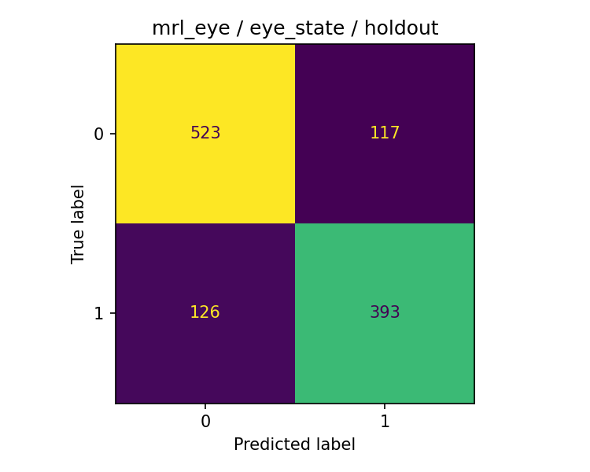
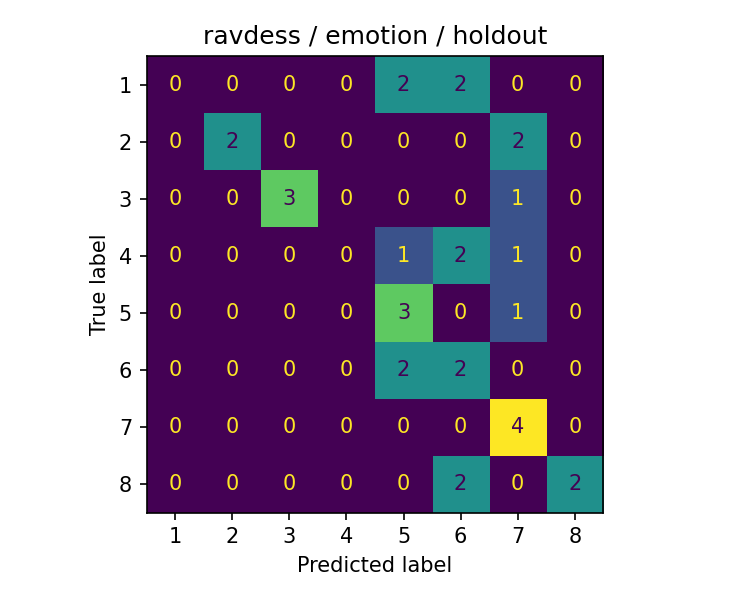

# Smoke test — hasil eksekusi

Laporan ini dibangun dari artefak run lokal. Tidak ada skor multimodal ATC fatigue yang telah diukur.

## Benchmark klasifikasi

| Dataset / target | Model | Holdout Macro F1 | Balanced accuracy | Accuracy |
| :--- | :--- | ---: | ---: | ---: |
| mrl_eye / eye_state | dummy_majority | 0.3558 | 0.5000 | 0.5522 |
| mrl_eye / eye_state | hog_linear_svm | 0.7877 | 0.7872 | 0.7903 |
| ravdess / emotion | dummy_majority | 0.0278 | 0.1250 | 0.1250 |
| ravdess / emotion | audio_only | 0.3116 | 0.3750 | 0.3750 |
| ravdess / emotion | visual_only | 0.2797 | 0.3438 | 0.3438 |
| ravdess / emotion | audio_visual | 0.4549 | 0.5000 | 0.5000 |

Per-class recall pada model HOG SVM MRL dan fusion RAVDESS:

| Dataset | Label | Recall | Support |
| :--- | :--- | ---: | ---: |
| mrl_eye | 0 | 0.8172 | 640 |
| mrl_eye | 1 | 0.7572 | 519 |
| ravdess | 1 | 0.0000 | 4 |
| ravdess | 2 | 0.5000 | 4 |
| ravdess | 3 | 0.7500 | 4 |
| ravdess | 4 | 0.0000 | 4 |
| ravdess | 5 | 0.7500 | 4 |
| ravdess | 6 | 0.5000 | 4 |
| ravdess | 7 | 1.0000 | 4 |
| ravdess | 8 | 0.5000 | 4 |

MRL: 0=closed, 1=open. RAVDESS: 1=neutral, 2=calm, 3=happy, 4=sad, 5=angry, 6=fearful, 7=disgust, 8=surprised.

MRL: 5285 gambar dari 37 subjek; split subjek terpisah, seed 42, model tetap tanpa hyperparameter search.

| Split MRL | Gambar | Subjek |
| :--- | ---: | ---: |
| test | 1159 | 8 |
| train | 3234 | 23 |
| validation | 892 | 6 |

Label MRL: 0=closed, 1=open. Sampling dibatasi per subjek/kelas; distribusi ini bukan estimasi prevalensi eye closure di operasi nyata. Duplikasi byte dan decoded pixels diperiksa sebelum split. Kedua model berhasil disimpan dan di-reload dengan prediksi holdout yang cocok.

## Audio ATCOSIM

100 utterances dari 1 speaker; total durasi 425.61 detik. Sumber HF third-party variant, 16 kHz. eGeMAPSv02: 88 fitur; MFCC: 26 ringkasan.

Quality counts: `{'ok': 100}`. Subset adalah first 100 viewer rows dan tidak representatif lintas speaker. Durasi utterance tidak diperlakukan sebagai speech duration hasil VAD. Tidak ada training atau fatigue score dari ATCOSIM.

Server WAV resmi timeout dari mesin ini. HF `/rows` gagal karena scan-size limit; loader menggunakan `/first-rows` untuk subset 100 baris. Revision yang teramati dan checksum setiap file dicatat pada manifest lokal.

## Visual temporal DROZY

360 windows dari 36 tests dan 14 subjek diproses. Kegagalan/exclusions: `[]`.

EAR dihitung dari 68 landmark; durasi memakai timestamp asli, gap >150 ms dikeluarkan dari coverage, window 60 detik memerlukan minimal 80% coverage. EAR threshold 0,21 adalah pilihan engineering yang belum dikalibrasi. PERCLOS memakai durasi closure yang telah teramati >=500 ms pada akhir window; blink singkat dikecualikan. Nilai ini belum merupakan estimator baku 80% eyelid closure.

QC overlay mata pada encoded frame 100/test 1-1 menunjukkan mapping indeks 36:42 dan 42:48 sesuai. QC gambar tetap lokal; pemeriksaan satu sampel bukan jaminan akurasi landmark seluruh dataset. Tidak ada interpolasi frame yang dianggap pengukuran asli.

Sensitivity check pada 36 tests, tanpa memilih threshold berdasarkan skor KSS:

| EAR threshold | Mean operational PERCLOS | Mean blinks/min |
| ---: | ---: | ---: |
| 0.18 | 0.0138 | 20.49 |
| 0.21 | 0.0173 | 24.37 |
| 0.24 | 0.0233 | 27.66 |

Model KSS tetap memakai threshold awal 0,21. Sensitivitas menunjukkan fitur bergantung pada definisi engineering; ini bukan kalibrasi klinis atau fatigue.

Regresi KSS menggunakan 36 baris agregat per test, 14 subjek, dan Leave-One-Subject-Out. Test berulang pada subjek yang sama tetap berkorelasi. Label KSS tidak dihitung sebagai label independen per window. Prediksi memakai seluruh test offline; tidak diklaim real-time.

| Model KSS | MAE | RMSE | Subject-macro MAE |
| :--- | ---: | ---: | ---: |
| dummy_mean | 2.0519 | 2.2704 | 2.1082 |
| ridge_alpha1 | 1.4544 | 1.8170 | 1.4405 |

## Paired fusion emotion RAVDESS

128 paired AV recordings dari 8 aktor. Seluruh model memakai holdout yang sama. Audio dan video diekstrak dari recording AV yang sama, normal intensity, statement 01, dua repetitions per emotion. Visual berupa face HOG mean/std dari sampling 2 FPS; tidak digunakan untuk blink/PERCLOS.

Split: `{'test': {'actors': ['02', '06'], 'rows': 32}, 'train': {'actors': ['01', '03', '05', '07'], 'rows': 64}, 'validation': {'actors': ['04', '08'], 'rows': 32}}`. Availability: `{'audio_available': 1.0, 'video_available': 1.0}`. Hasil berasal dari subset aktor kecil, sehingga kestabilan dan generalisasinya terbatas. Fusion tidak diasumsikan selalu mengungguli unimodal.

Pada split run ini, training memakai aktor bernomor ganjil (male menurut metadata RAVDESS), sedangkan validation/test genap (female). Demographic shift ini membatasi interpretasi hasil. Split tidak diubah setelah skor holdout dilihat; studi berikutnya perlu protokol keseimbangan yang ditetapkan sebelum evaluasi.

Ablation missing-modality adalah stress test saat inference; tidak mengklaim model sudah dilatih atau terbukti robust terhadap modalitas hilang.

| Skenario fusion pada test | Macro F1 | Balanced accuracy |
| :--- | ---: | ---: |
| all_audio_missing | 0.2500 | 0.3125 |
| all_video_missing | 0.2222 | 0.3438 |

## Resource dan reproduksi

Environment pribadi `.venv`, Python 3.10.4, dependensi dalam `requirements.lock.txt`. Ekstraksi/training menggunakan CPU dengan batas thread; GPU A100 80 GB hanya diaudit dan tidak dipakai training. Lihat [environment audit](environment_audit.md), [dataset audit](dataset_audit.md), dan [panduan menjalankan](../docs/getting-started.md). Data, fitur, model, prediction files, dan run logs disimpan lokal dan diabaikan Git.

## Batasan dan pekerjaan lanjutan

IEEE ATC corpus DOI 10.21227/70sz-mj23 teridentifikasi, tetapi unduhan memerlukan login/subscription. Benchmark audio fatigue belum dijalankan. Paired ATC fatigue benchmark, GRU/TCN, dan pengumpulan data operator nyata menunggu data/izin/protokol yang sesuai. KSS sleepiness, eye state, dan emotion tidak disamakan dengan fatigue ATC.

## Sumber dataset

- [MRL Eye](https://mrl.cs.vsb.cz/eyedataset.html)
- [ATCOSIM resmi](https://www.spsc.tugraz.at/databases-and-tools/atcosim-air-traffic-control-simulation-speech-corpus.html) dan [HF variant](https://huggingface.co/datasets/Jzuluaga/atcosim_corpus)
- [DROZY](https://www.drozy.uliege.be/) — Massoz et al., WACV 2016, DOI 10.1109/WACV.2016.7477715
- [RAVDESS](https://zenodo.org/records/1188976) — Livingstone & Russo (2018), DOI 10.1371/journal.pone.0196391
- [IEEE ATC Fatigue Corpus](https://ieee-dataport.org/documents/air-traffic-controller-radiotelephony-fatigue-corpus)
